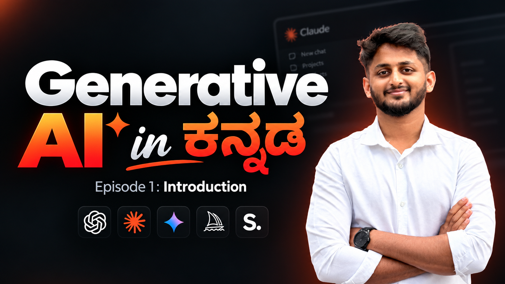

# AI Engineering in Kannada

This repository contains AI course materials and learning resources shared in Kannada for beginners and learners who want to understand AI and engineering concepts in a simple way.

## Course videos

[](https://youtube.com/playlist?list=PLEGzkK9VVrK8)

[](https://youtube.com/playlist?list=PLEGzkK9VVrK8)

▶️ **Playlist:** <https://youtube.com/playlist?list=PLEGzkK9VVrK8>

## Overview

The goal of this repo is to organize learning content, slides, PDFs, and future course episodes in one place.

## Curriculum

The course currently covers prompt engineering, tool calling, how Transformers work, LangChain, RAG and ReAct agents, across 10 episodes. See the full plan in [CURRICULUM.md](CURRICULUM.md).

## Repository structure

- `Episode 1/` - Initial course material and introductory content
  - `AI Basics Video 1.pdf` - Introduction to AI basics
- `Episode 2/` - Running local AI models with Ollama and Python
  - `NOTES.md` - Theory notes: Ollama installation, `generate()` vs `chat()`, message roles, chatbot memory, glossary
  - `first_program.py` - A plain Python program to check that Python works
  - `first_ai_program.py` - One-shot text generation with `ollama.generate()`
  - `roles.py` - Using `system` and `user` message roles with `ollama.chat()`
  - `chat_bot.py` - A terminal chatbot that remembers the conversation history
- `Episode 3/` - Prompt engineering
  - `NOTES.md` - Theory notes: the five building blocks of a prompt, zero-shot vs few-shot, chain-of-thought, prompt checklist, glossary
  - `prompts.py` - One prompt improved step by step, plus zero-shot, few-shot and think-first examples
- `assets/` - Images used in this README (course thumbnail)

## Getting started (Episode 2)

The Episode 2 programs run an LLM locally using [Ollama](https://ollama.com/download).

1. Install Ollama from <https://ollama.com/download> and make sure it is running.
2. Download the model used in the examples:
   ```bash
   ollama pull llama3.2
   ```
3. Install the Python library:
   ```bash
   pip install ollama
   ```
4. Run a program:
   ```bash
   cd "Episode 2"
   python3 chat_bot.py
   ```
   Type `bye` to exit the chatbot.

See [Episode 2/NOTES.md](<Episode 2/NOTES.md>) for detailed setup steps, common errors, and explanations.

## Purpose

This project is a lightweight collection of course study materials for:

- learning foundational AI concepts
- following beginner-friendly lessons in Kannada
- keeping course resources organized in a single repo

## Notes

This is a growing repository. More episodes and materials can be added over time.
